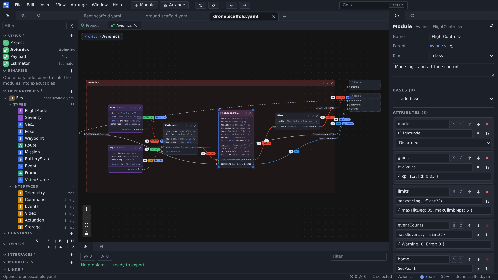

# ProjectScaffold-Viewer

Browser editor for software architecture: modules, ports, typed interfaces and constrained links.
Saves a language-agnostic YAML/JSON file meant to feed code skeleton generators, such as [ProjectScaffold-Generator](https://github.com/MickaelBlet/ProjectScaffold-Generator).



## Features

- **Diagram editor**: nested modules with ports, attributes, methods and types of their own, C++-like classes and inheritance with access levels, links with constraints (direction, acknowledgement, performance, transport), ELK auto-layout, views per module.
- **Text and diagram together**: the YAML/JSON file is editable as text beside the diagram, with completion and live validation.
- **Multi-project architectures**: projects depend on each other's types, interfaces and modules; renames follow; workspace files open them all at once.
- **IDL import**: OMG IDL 4.2 files (CORBA, CCM, DDS / XTypes) as imports or dependencies.
- **Everywhere**: one self-contained `index.html` for the browser, desktop apps (Tauri, Electron), and the pages of the VS Code extension ([ProjectScaffold-VsCode](https://github.com/MickaelBlet/ProjectScaffold-VsCode)).

Code is generated from the project files by [ProjectScaffold-Generator](https://github.com/MickaelBlet/ProjectScaffold-Generator) (C++, Python, SCA).

## Quick start

```sh
npm install
npm run dev     # open the editor, then File › Open… examples/robot.scaffold.yaml
```

[`examples/`](examples) holds sample projects; [`examples/fleet/fleet.scaffold-workspace.yaml`](examples/fleet/fleet.scaffold-workspace.yaml) opens a multi-project one.

## Documentation

| Guide                                    | Content                                                                   |
| ---------------------------------------- | ------------------------------------------------------------------------- |
| [Building and running](docs/building.md) | web, desktop, checks                                                      |
| [Editor](docs/editor.md)                 | documents, panels, views, text editor, diagram, binaries, settings        |
| [Keyboard shortcuts](docs/shortcuts.md)  | every shortcut, by menu                                                   |
| [File format](docs/file-format.md)       | types, constants, interfaces, modules, ports, links, binaries, transports |
| [Dependencies](docs/dependencies.md)     | projects using other project files, importing projects, workspace files   |
| [IDL files](docs/idl.md)                 | importing OMG IDL and how it maps to the model                            |

Changes: [`CHANGELOG.md`](CHANGELOG.md).

## License

[MIT](LICENSE)
